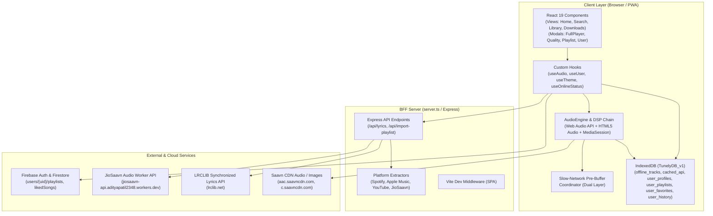

# AI_BRAIN.md — Architectural Blueprint & Execution Flows

## 1. High-Level Architecture Overview

---

## 2. End-to-End Core Execution Flows

### Flow 1: App Boot & Session Hydration
1. `index.html` loads fonts, PWA manifest, viewport meta, and mounts `src/main.tsx`.
2. `App.tsx` initializes `ThemeProvider` and `UserProvider`.
3. `ThemeContext` reads `localStorage` for theme (`midnight`, `obsidian`, `emerald`, `crimson`, `daylight`) and font selection, applying data-attributes to `<html>` and updating `<meta name="theme-color">`.
4. `UserContext` initializes:
   - Configures `setPersistence(auth, browserLocalPersistence)` to maintain permanent sessions across restarts.
   - Listens to Firebase auth state via `onCloudAuthChange`.
   - If authenticated with Google:
     * Immediately transitions `authState` to `'authenticated'`.
     * Hydrates user profile, preferred bitrate, and DSP EQ settings.
     * Starts real-time bi-directional Firestore synchronizer for `users/{uid}/playlists` and `users/{uid}/likedSongs`, merging with local IndexedDB caches.
   - If not authenticated with Google:
     * Checks `localStorage` for `'tunely_guest_mode'`. If present, enters Restricted Guest mode (`'guest'`).
     * If unauthenticated on a fresh visit, displays `LoginGateModal` allowing **Continue with Google** or **Continue as Guest**.
5. `SplashScreen` displays brand animation while initial feeds and audio state preload.

### Flow 2: Search & Music Discovery
1. User types in `SearchView` or selects a genre from `HomeView`.
2. Input is debounced (220ms) and sanitized with `sanitizeSearchQuery` (enforces 2-char minimum for debounced live search).
3. If online:
   - Dispatches parallel queries to `/api/search/songs` and `/api/search/albums`.
   - When an album matches the search query (e.g., movie soundtracks like "Ae Dil Hai Mushkil"), fetches its canonical tracklist via `/api/albums?id=...` and merges tracks into the candidate pool.
   - If initial candidates are empty, generates query variants (`generateSearchQueryVariants`) for known typo corrections (e.g., "Arjit" -> "Arijit", "chann mere ya" -> "channa mereya") and separated artist names.
   - Ranks all candidate songs using multi-tier relevance scoring (`rankSongsByFameAndRelevance`): exact matches (Tier 1: +320/260/230), prefixes (Tier 2: +210/170/160/140), multi-word token coverage & Dice-Sørensen bigram fuzzy matching (Tier 3: up to +240 + synergy bonuses), and capped play-count tie-breaker (Tier 4: max 25 points).
   - Diversifies results via `diversifyForQuery` (allowing up to 4 tracks per album for soundtrack searches, 1 track per album for general discovery).
   - Caches results into memory and IndexedDB `cached_api` for instant offline hits.
4. If offline:
   - Falls back to `localDB.searchCachedSongs(query)` which tokenizes the query across composite `title + artists + album` strings, finds all matching tracks from `cached_api` and `offline_tracks`, and ranks them by relevance.

### Flow 3: Music Playback & Audio DSP Pipeline
1. User taps a song in a list or hero card.
2. `useAudio().playSong(song, queue)` calls `audioEngine.playSong()`.
3. Audio engine checks if the song is available in `offline_tracks` (IndexedDB):
   - **If Offline Blob Found**: Creates a blob URL (`URL.createObjectURL(track.audioBlob)`) and feeds it directly into `audio.src`.
   - **If Streaming**: Uses `resolveBestStreamUrl(song, preferredQuality)` to pick the appropriate bitrate URL.
4. Audio output routes through the Web Audio mastering chain:
   `Source -> preGain (Dynamic Headroom Attenuation via computeHeadroomAttenuation) -> Subsonic Filter (18Hz) -> 5-Band Parametric EQ (70Hz, 130Hz, 320Hz, 3.2kHz, 11kHz) -> DynamicsCompressorNode -> makeupGain -> Stereo Width Matrix -> WaveShaperNode (smooth soft-ceiling curve) -> masterGain (De-zippered Output Volume) -> Destination`.
5. Headroom attenuation scales pre-gain dynamically based on active EQ boosts and makeup gain, guaranteeing peak levels entering the soft-ceiling wave shaper never exceed 0 dBFS ($|x| \le 1.0$) and preventing headset distortion at high volume.
6. Updates lock-screen controls via `navigator.mediaSession` with track metadata, artwork, and action handlers (`play`, `pause`, `previoustrack`, `nexttrack`, `seekto`). Explicitly clears `seekbackward` and `seekforward` to `null` so iOS displays Next/Previous track buttons instead of 15s skip buttons.
7. The dual-layer slow-network pre-buffer coordinator warms up the next track in queue silently.

### Flow 4: Synchronized Lyrics
1. When `FullPlayerModal` expands, it calls `musicAPI.getSongLyrics(song)`.
2. Backend `/api/lyrics` queries:
   - Primary: LRCLIB exact match (`https://lrclib.net/api/get`) by title and primary artist.
   - Secondary: LRCLIB fuzzy search (`https://lrclib.net/api/search`).
   - Fallback: JioSaavn plain lyrics endpoint.
3. Lyrics are parsed into timestamped lines `LyricLine[]` via `parseLrcLyrics`.
4. As playback position advances, `findActiveLyricIndex` highlights the current line and smoothly auto-scrolls the active lyric to the center.

### Flow 5: Universal Playlist Importer
1. User pastes a Spotify, Apple Music, YouTube/YT Music, JioSaavn link, or raw tracklist into `PlaylistModal`.
2. Auth check ensures user is signed in with Google (`!isGuest && isLoggedIn`); displays an inline sign-in banner and triggers `LoginGateModal` for guests.
3. Link imports use `POST /api/import-playlist` for SSR extraction. Text imports use the shared parser locally. The endpoint also accepts text for API callers.
   - **Spotify**: Parses public embed `__NEXT_DATA__` trackList.
   - **Apple Music**: Parses schema.org `application/ld+json` and `serialized-server-data`.
   - **YouTube**: Parses `ytInitialData` and continuation tokens up to 450 items.
   - **JioSaavn**: Fetches playlist JSON directly from worker API.
4. The client resolves tracks against the catalog with up to eight workers and preserves input order. Text rows support artist-first dash notation, legacy title-first notation, CSV, and title-only lines. Matching verifies the title and supplied artist before saving.
5. Tracks are validated and sanitized via `sanitizePlaylistImportTracks` (stripping all `undefined` fields, assigning fallback IDs, bounding durations).
6. One IndexedDB transaction commits the populated playlist before the UI offers Open Playlist. One Firestore document write syncs that same ordered list asynchronously.
7. The playlist listener uses confirmed snapshots. It compares revisions, retains newer local edits, and applies confirmed remote removal and order changes.

### Flow 6: Offline Downloads
1. User taps Download icon on any track.
2. `UserContext.downloadSongForOffline` streams the audio blob using `ReadableStream` with granular percentage progress tracking.
3. The downloaded `Blob` is stored inside IndexedDB object store `offline_tracks`.
4. When disconnected from the internet, `useOnlineStatus` detects offline state and the app seamlessly plays audio directly from IndexedDB without network requests.

---

## 3. Known Quirks, Edge Cases & Technical Debt

1. **Vite / Esbuild Peer Dependency Resolution (Resolved in M1)**:
   - Handled cleanly via root `.npmrc` (`legacy-peer-deps=true`), allowing standard `npm install` without manual flags.
2. **Package Name Metadata (Resolved in M1)**:
   - Normalized `package.json` name from `"react-example"` to `"my-tunely-2"`.
3. **Vite Config Native Loader Warning (Resolved in M1)**:
   - Modernized `path.resolve` in `vite.config.ts` to use `import.meta.dirname` instead of `__dirname`.
4. **Vite Chunk Splitting (Resolved in M1)**:
   - Configured `build.rollupOptions.output.manualChunks` to split heavy vendor modules (`vendor-firebase-firestore`, `vendor-firebase-auth`, `vendor-firebase-core`, `vendor-react`, `vendor-icons`, `vendor-motion`). All individual chunk bundles are under 500 kB.
5. **npm test Script (Resolved in M1)**:
   - Added `"test": "tsx --test src/utils/audioCore.test.ts"` to `package.json` for standard test execution.
6. **iOS MediaSession Next/Previous Controls (Resolved in M2.1)**:
   - WebKit on iOS prioritizes `seekbackward`/`seekforward` over track navigation. Fixed via `registerMediaSessionActions` in `src/utils/audioCore.ts` which explicitly sets `seekbackward` and `seekforward` to `null`, ensuring Next and Previous buttons render on iOS Lock Screen, Dynamic Island, and Control Center.
7. **Search Engine Relevance & Multi-Word Typo Discovery (Resolved in M2.2)**:
   - Fixed exact short title demotions, multi-word cross-field artist/title typos, and movie soundtrack queries via tokenized fuzzy matching and dual-stage ranking in `rankSongsByFameAndRelevance`.
8. **Persistent Google Auth, Cross-Device Sync & Restricted Guest Mode (Resolved in M2.3)**:
   - Added persistent Google auth (`browserLocalPersistence`), bidirectional Firestore sync for playlists and favorites with conflict-free offline merging, removed mock test accounts, created `LoginGateModal`, and restricted guest mode quotas.
9. **Headset Audio Scattering & Sudden Volume Spikes (Resolved in M2.4)**:
   - Root-caused ~80% headset distortion to EQ summing overflow (+8 to +12 dBFS) flatlining against `createSoftCeilingCurve()`. Resolved with dynamic pre-gain headroom attenuation (`computeHeadroomAttenuation`), dedicated de-zippered `masterGain` output node, and smooth asymptotic soft-saturation. Output volume is decoupled from Web Audio DSP input, eliminating unprompted volume spikes during track switches and resumes.
10. **Playlist Importer Save & Track Persistence (Resolved in M2.5)**:
    - Root-caused missing/0-song imported playlists to: (a) unhandled guest mode in `handleStartImport` silently aborting saves, (b) destructive cloud playlist merging in `mergeCloudAndLocalPlaylists` where empty cloud snapshots wiped populated local records, and (c) Firestore `undefined` field rejections.
    - Resolved via `sanitizePlaylistImportTracks` (stripping all undefined fields), non-destructive anti-wipe cloud playlist merge logic in `mergeCloudAndLocalPlaylists`, atomic IndexedDB writes with awaited Firestore sync in `createPlaylistWithSongs`, and upfront guest validation with inline sign-in gate in `PlaylistModal`.
11. **Firebase Unauthorized-Domain Diagnostics & Localhost Normalization (Resolved in M2.6)**:
    - Root-caused local developer Google sign-in rejections on `127.0.0.1` vs `localhost` and uninformative `auth/unauthorized-domain` messages.
    - Added `formatFirebaseAuthError` in `guestLimits.ts`/`firebase.ts` providing exact current hostname guidance and directions for Firebase Console settings.
    - Added automatic `127.0.0.1` → `localhost` URL normalization in `src/main.tsx` before React mount.
12. **Search Relevance, Derivative Penalties & Near-Duplicate Tracks (Resolved in M2.8)**:
    - Addressed issue where covers, karaoke, and low-quality derivative edits outranked original studio releases for standard queries, and duplicate catalog releases cluttered search results.
    - Implemented calibrated derivative modifier penalties (-150) in `rankSongsByFameAndRelevance` with query-intent bypass (+200 for explicit derivative requests), multi-word collaboration synergy bonuses (+280), expanded vernacular query dictionaries, and near-duplicate track deduplication (`deduplicateNearIdenticalSongs`) preserving valid 320kbps streams and rich metadata.
13. **Static Firebase Hosting & Direct Upstream Fallback (Resolved in M3)**:
    - Configured `.firebaserc` and `firebase.json` for the `my-tunely` Hosting project, mapping `dist/` PWA static assets with explicit no-cache headers for `/index.html` and service workers, and immutable cache for `/assets/*`.
    - Preserved `cellular-spark-p01dl` for Authentication and the named Firestore database `ai-studio-tunelymobilepwam-9ddbd400-6d72-4665-a6d5-ea6ba78023d9`; Hosting configuration does not deploy Firestore rules.
    - Added direct client-side upstream fallback in `src/services/api.ts` when `/api/lyrics` or `/api/import-playlist` receives SPA HTML rewrites on static hosting, enabling lyrics directly via LRCLIB/JioSaavn and JioSaavn link playlist imports.

## 4. Milestone status

| Milestone | Status |
|---|---|
| M0-M2.6 | Prior local milestones recorded through ADR-013. Baseline verified at 27/27 unit tests on HEAD 2c4b06d plus existing workspace changes. |
| M2.7 Playlist Sync & Text Import | Completed and verified locally (P1 SSRF hop validation, P2 concurrent multi-browser live sync merge, P3 repo hygiene, Firestore 403 rules permission fix, actionable error surfacing, strict song field whitelisting, SYNC-001 revision gap preservation, SYNC-003 authoritative last-song remote deletion propagation, SYNC-002 modal sync failure handling, and strict firestore.rules isValidSongMap schema alignment). 41/41 unit tests, TypeScript (`tsc --noEmit`), production PWA build, npx eslint firestore.rules, and git diff --check passed. |
| M2.8 Search Ranking | Completed and verified locally (calibrated derivative demotion for covers/karaoke/slowed-reverb, collaboration intent scoring, Hindi/vernacular typo expansions, and near-duplicate track deduplication preserving 320kbps stream quality). 44/44 unit tests, TypeScript (`tsc --noEmit`), production PWA build, and `git diff --check` passed. |
| M2.9 Security Audit & Local Commit | Completed clean local commit (verified zero secrets/.env staged, 44/44 unit tests, lint, and build passing). |
| M3 Firebase Hosting and Named Database | Completed and live at https://my-tunely.web.app (Hosting project: my-tunely; Auth/DB: cellular-spark-p01dl). 44/44 unit tests, lint, and build passing. |
